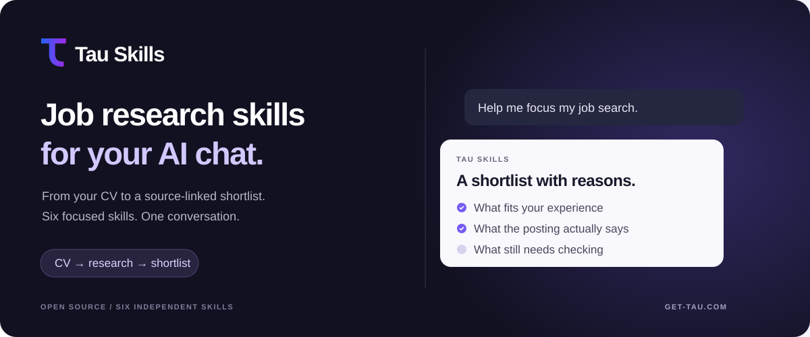

<p align="center">
  <a href="https://get-tau.com"></a>
</p>

<h1 align="center">Tau Skills — LinkedIn Job Search Skills</h1>

<p align="center"><strong>Turn your CV and search preferences into an evidence-based job shortlist.</strong></p>

<p align="center">
  <a href="LICENSE"></a>
  <a href="#skills"></a>
  <a href="#try-it-in-chat"></a>
</p>

<p align="center">
  <a href="#connect-to-codex-desktop">Install Skills</a>
  ·
  <a href="#try-it-in-chat">Try it in chat</a>
  ·
  <a href="docs/workflow.md">Workflow</a>
  ·
  <a href="https://github.com/ArsenOria/tau-linkedin-job-research-mcp">Scout MCP</a>
  ·
  <a href="https://get-tau.com">Explore Tau</a>
</p>

Tau Skills provides six open-source **LinkedIn job search skills** for an AI-assisted search: turn your CV into a focused brief, plan LinkedIn queries, research roles and compare the evidence in chat. Start with your preferences; finish with a shortlist that explains fit, gaps and unanswered questions.

The optional [**Tau Scout — LinkedIn Job Search MCP Server**](https://github.com/ArsenOria/tau-linkedin-job-research-mcp) companion repository supplies a **LinkedIn job search MCP server** using **your own Apify account**. There is no Tau backend, Tau account or shared API key. A configured host assistant calls the tools and presents the results in chat; you do not run search commands or transfer reports between applications.

For a **Codex job search skill** workflow, use the [Codex chat guide](docs/codex-job-search-skill.md) and the installation steps below. Looking for a **LinkedIn job search skill for Claude**? The [Claude Code setup guide](docs/claude-linkedin-job-search.md) explains the local skill and optional Scout connection. **Tau's recorded end-to-end chat validation is in Codex; the Claude Code route has not yet been validated end to end.**

## How LinkedIn job search works in chat

| 1. Focus the search | 2. Research the roles | 3. Review the evidence |
|---|---|---|
| Share your CV and constraints; build a job search brief. | Use Scout or the host assistant's available public-web tools. | Compare requirements, remote eligibility and unanswered questions. |

The result is an **evidence-based job shortlist** that you can refine in the same conversation. Skills cover the reasoning workflow; Scout supplies optional local search tools.

## Skills

| Skill | Use it to |
|---|---|
| [`job-search-brief`](skills/job-search-brief/SKILL.md) | Turn a CV and preferences into a focused search brief |
| [`linkedin-search-plan`](skills/linkedin-search-plan/SKILL.md) | Prepare job-title queries and LinkedIn searches |
| [`job-research`](skills/job-research/SKILL.md) | Find and compare vacancies using Scout or the host's web tools |
| [`fit-review`](skills/fit-review/SKILL.md) | Compare the actual requirements with CV evidence |
| [`company-brief`](skills/company-brief/SKILL.md) | Research a company using the host's public-web tools |
| [`shortlist-review`](skills/shortlist-review/SKILL.md) | Refine and prioritize the saved shortlist in conversation |

Each skill folder installs independently. None requires the other five. Installation uses the host's skill mechanism; Scout needs a client that can launch **local stdio MCP servers**. We do not claim support for every chat application. See [installation](docs/installation.md) and the [workflow](docs/workflow.md).

## Connect to Codex desktop

Skills provide instructions; Scout provides tools. Install both for the complete chat workflow.

1. Download or check out [this repository](https://github.com/ArsenOria/tau-job-research-skills). In Finder/file manager, open your user folder's `.agents/skills` directory (create it if needed).
2. Copy the **six individual folders inside `skills/`** into that directory. For example, the result must be `~/.agents/skills/job-research/SKILL.md` with its `references/` beside it. Do not copy only `SKILL.md`, or nest the entire repository under another skill folder. If a same-named skill already exists, review it before replacing it.
3. In Codex, ask to use `job-search-brief` or select the skill. If it does not appear, restart Codex. See [official skill setup](https://learn.chatgpt.com/docs/build-skills).
4. Install the `tau-job-scout` package from the companion [Tau Scout repository](https://github.com/ArsenOria/tau-linkedin-job-research-mcp#first-connection) and add its local STDIO MCP connection. Its README has the full Codex `config.toml` example. You need the Scout executable's absolute path, not this repository's path.
5. Add your own Apify token to the Scout connection's `APIFY_TOKEN` environment setting. Obtain it at [Apify Console → Settings → API & Integrations](https://console.apify.com/settings/integrations). Never paste it into a chat or commit it. Scout does **not** load a repository `.env` automatically.

After the MCP server has been saved/restarted, send this **free connection check**:

> Use job-research. Check whether Scout is connected and whether APIFY_TOKEN is configured, without showing its value. Do not start a search or make paid requests.

Expected: Scout's `get_scout_status` is called and reports capabilities plus a token-presence boolean. That boolean does not validate the token or balance with Apify. If the assistant cannot discover Scout, finish the MCP setup first; reading these skill files alone does not connect the server.

Next, try the synthetic demo. A real search can follow with an explicit result/spending cap. [Step-by-step manual checkpoints](docs/installation.md#manual-checkpoints) keep setup, free demo and live search separate.

## Try it in chat

> Here is my CV. Find product analyst jobs in Berlin or remote in Germany from the past week. I can work in Germany without sponsorship. Show what fits and what you cannot verify.

> Remove recruitment agencies and prioritize roles involving SQL and experiments. Keep jobs with unknown salary in a separate group.

> Research the first company and explain why you would put this role ahead of the second.

The assistant uses the same conversation for follow-up questions and refinements. [The demo conversation](examples/demo-conversation.md) shows the complete offline flow with clearly synthetic companies. It makes no paid requests.

A [live integration exercise](docs/LIVE_TEST.md) also applied these skills to five real Scout results with a synthetic candidate, including description-level fit review and official-source company research. It does not establish automatic installation/discovery in all chat clients.

A subsequent [native Codex output review](docs/OUTPUT_QUALITY.md) used the installed skills and configured MCP server on ten observed jobs and three synthetic profiles. It includes the captured model answer and its quality limitations.

The [Scout 0.2 native answer in Russian](docs/NATIVE_OUTPUT_V2_RU.md) repeats those profiles with experience, seniority, remote-country constraints, normalized skills and employer/publisher separation. All user interaction remains in the AI chat.

Scout v0.3 additionally separates publication claims from collection time, distinguishes employer/publisher/recruiter/client identity and evaluates student-program relevance and education/placement requirements. Supply only evidenced student facts; unknown grades, study progress and placement permission remain unknown. Earlier output captures above remain historical; they do not establish current openings or v0.3 behavior.

## Setup guides

- [Codex job search skill: from CV to shortlist in chat](docs/codex-job-search-skill.md) — the host used in our recorded manual exercises.
- [LinkedIn job search skill for Claude: Claude Code setup](docs/claude-linkedin-job-search.md) — instructions based on vendor documentation; Tau end-to-end validation is pending.
- [Search positioning and competition evidence](docs/SEARCH_POSITIONING.md) — dated Google observations, demand proxies and their limits.

## Access and evidence

- Scout's Apify source uses a third-party Actor. Receiving a listing does **not** independently verify that it is still open, complete or correctly categorized.
- Dates, salary, remote eligibility and sponsorship may be unknown. Missing evidence stays unknown.
- Your CV is handled by the AI host under that host's data policy. Scout needs only a minimal structured profile for local matching. The search sent to Apify contains job-search parameters, not your CV or contacts.
- Connect your own `APIFY_TOKEN` through your client's protected secret or environment configuration, never by pasting it into chat. Live searches use your Apify balance and have disclosed caps. Scout has no hosted Tau proxy.
- Skills and Scout do not log in to LinkedIn, apply, send messages, automate a browser or monitor in the background. LinkedIn's [User Agreement](https://www.linkedin.com/legal/user-agreement) restricts automated access and scraping; using an Apify Actor is not official LinkedIn permission.

## Development

```bash
python3 -m venv .venv
.venv/bin/python -m pip install -r requirements-dev.txt
.venv/bin/python checks/validate.py
.venv/bin/python checks/package_skills.py
```

These are maintainer checks and packaging commands, not the user's job-search interface. Packaging writes one independently installable ZIP per skill to `dist/`. Behavioral evaluation scenarios live in [checks/scenarios.md](checks/scenarios.md); structural checks cannot prove research quality.

MIT licensed. See [LICENSE](LICENSE), [CONTRIBUTING](CONTRIBUTING.md), the [updated plan in Russian](PLAN_RU.md), the [Scout tool-reference snapshot](skills/job-research/references/scout-tools.md), and the [implementation boundary](docs/porting-boundary.md). No live Apify call was required to build the skills.
